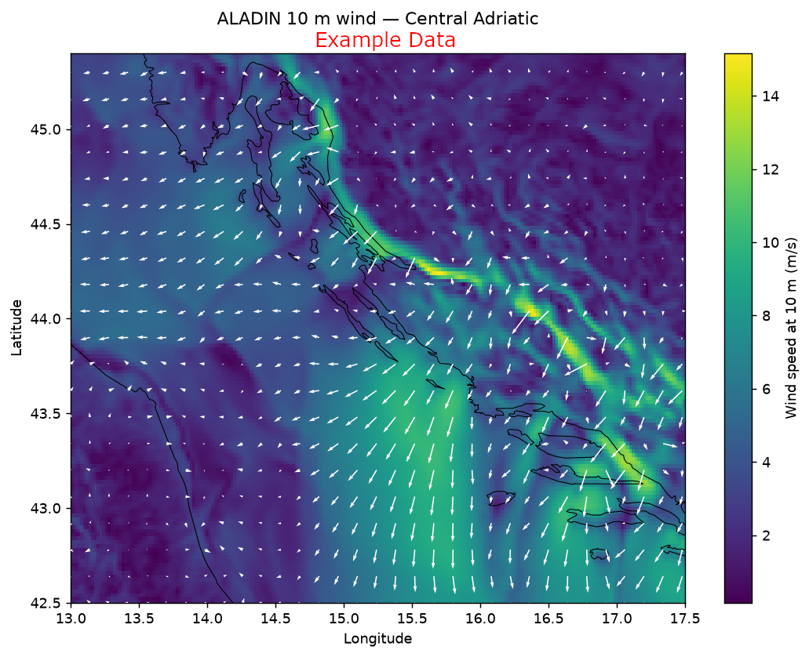

# aladin-grib-adria

Automated downloader, cutter, reprojection, and merger of CHMI Aladin 2.3km GRIB files for the central Adriatic. Reads publicly availabe CHMI weather data, and generates usable grib files for a defined bounding box in the central adriatic.



## Run Via GitHub Actions

A workflow is scheduled every hour (GitHub fires only a few of these per day) and publishes the latest data to the `gh-pages` branch.
No server setup required.

The pipeline has four jobs:

1. **check** — a lightweight Alpine-based container runs `check_availability.py`, which scrapes the CHMI OpenData directory and verifies that all 6 required variables for the latest model run (00/06/12/18 UTC) are present. It decides separately for the wind file and the water file whether that run still needs processing; if neither does, the other jobs are skipped.

2. **wind** — builds the processor image, downloads and processes the ALADIN GRIB files, renders a static wind map and validates the result.

3. **marine** — builds the same image and creates the Copernicus water file (see below). It does not depend on `wind`: if one of the two fails, the other still runs.

4. **publish** — runs whenever something was processed, even if a job failed. Each file is taken from its new run if that job succeeded, otherwise the previously published file is kept. It writes a status line and, if a file is stale, a warning on the website and in the `gh-pages` README, then force-pushes a single-commit orphan to `gh-pages`. A failed file is retried at the next scheduled run.

To test a change without publishing, dispatch the workflow from a branch with `dry_run` (the assembled site is uploaded as an artifact; only runs on `main` that are not dry runs deploy). `force` reprocesses the latest run, and `simulate` (with `dry_run`) makes the wind or marine job fail on purpose.

## Wind Map

Each processing run renders a static PNG of 10m wind speed and direction over the Adriatic bounding box, with a coastline overlay (clipped from Natural Earth 10m coastline data, bundled in [`adriatic_coastline.json`](adriatic_coastline.json)). It's generated with CDO + matplotlib and embedded directly in the [`gh-pages` README](https://github.com/k-schreiber/aladin-grib-adria/tree/gh-pages).

## Water File (Copernicus Marine)

`copernicus_adriacenter_<YYYYMMDDHH>.grb` (and `copernicus_adriacenter_latest.grb`) holds the surface current (ocean and tide, `uo`/`vo`) and the waves (height, direction and period, plus wind-sea and primary swell) from the Copernicus Mediterranean forecast. It covers the same hourly steps (0-72) of the same ALADIN run as the wind file, on the **native 1/24° grid, not regridded**, in GRIB1 with the same header conventions. Land points are missing values (a bitmap).

- Code: [`marine_grib.py`](marine_grib.py) fetches a server-side subset, [`grib_validate.py`](grib_validate.py) checks the result, [`build_site.py`](build_site.py) assembles the published site.
- **Credentials:** the `COPERNICUSMARINE_SERVICE_USERNAME` and `COPERNICUSMARINE_SERVICE_PASSWORD` repository secrets (a free Copernicus Marine account). For local tests put the same two keys into `secrets.yaml` (git-ignored) and run `python3 scripts/with_secrets.py -- python3 marine_grib.py --timestamp 2026112318 --outdir out`; the values are never printed.
- **Dataset versions are pinned** in `marine_grib.py`, because a new version is a new model release with different values on the same grid. Each run logs newer versions and retirement dates: currents `202511` retires on **2027-01-12** (a newer `202611` exists), so the pin must be reviewed and changed before then.
- Contains modified Copernicus Marine Service information: https://doi.org/10.48670/mds-00359 (currents), https://doi.org/10.48670/mds-00373 (waves).


## Run locally

```bash
# Build and start
docker-compose up -d

# View logs
docker-compose logs -f

# Enter container shell
docker-compose exec aladin /bin/bash

# Stop
docker-compose down

# Rebuild after changes
docker-compose up -d --build
```

Access Once running:

Web interface: http://localhost:8080

Latest file: http://localhost:8080/aladin_adriacenter_latest.grb

Shell access:
```bash
docker exec -it aladin-grib /bin/bash (or docker-compose exec aladin /bin/bash)
```

## Deploy on Fly.io

```bash
fly launch --name aladin-grib-adria --no-deploy
fly volumes create data --size 5 --region fra
docker build -t aladin-grib-adria .
fly deploy --image aladin-grib-adria --app aladin-grib-adria
```
Then access:
https://aladin-grib-adria.fly.dev/aladin_adriacenter_latest.grb

## Tests

```bash
python3 -m unittest discover -s tests -t .
```

The tests need no network, Docker or CDO and run on every pull request. Tests that exercise `numpy`, `eccodes`, `requests` or `matplotlib` are skipped when those are not installed (`pip install numpy matplotlib requests beautifulsoup4 eccodes`).

## About This Data
          
- **Source**: Czech Hydrometeorological Institute (CHMI) - ALADIN model
- **Model**: ALADIN Lambert 2.3km grid
- **Region**: Central Adriatic Sea (13.0-17.5°E, 42.5-45.4°N)
- **Resolution**: 0.02° (~2.2 km) regular lat-lon grid
- **Update frequency**: Roughly every 6 hours by CHMI, processed here within 1 hour
- **Variables included**:
  - Mean Sea Level Pressure (MSLP)
  - Wind Speed and Direction at 10m
  - Wind Gusts (u/v components)
  - Temperature at 2m

## How It Works

1. **Check** a lightweight Alpine container (`check_availability.py`) scrapes the CHMI OpenData directory and verifies all 6 required variables are present for the latest model run. If the timestamp is already cached, processing is skipped entirely.
2. **Download** the latest ALADIN model data from CHMI every hour
3. **Process** the GRIB files using CDO:
   - Reproject from Lambert to regular lat-lon grid
   - Subset to Adriatic region bounding box
   - Merge multiple variables into single file
4. **Publish** to this `gh-pages` branch for public access
          

## Full Weather Parameter Descriptions
Project is based on CHMI weather data. Original data, parameter list and descriptions can be found at:
https://opendata.chmi.cz/meteorology/weather/nwp_aladin/

Parameters in **bold** are included in the merged output file.

| Parameter Name | Description | Units |
|----------------|-------------|-------|
| SURFGEOPOTENTIEL | Geopotential of model surface (orographic height) | [m^2/s^2] |
| SURFIND_TERREMER | Land-sea mask (land=1, sea=0) | [fraction] |
| **MSLPRESSURE** | Mean sea level pressure | [Pa] |
| SURFTEMPERATURE | Surface temperature | [K] |
| **CLSTEMPERATURE** | Temperature at 2m | [K] |
| CLSMAXI_TEMPERAT | Maximum temperature at 2m (in 6h at 18 UTC) | [K] |
| CLSMINI_TEMPERAT | Minimum temperature at 2m (in 6h at 18 UTC) | [K] |
| CLSDEW_P_TEMPER | Dew point temperature at 2m | [K] |
| CLSTPRIM_M | Wet bulb temperature at 2m | [K] |
| CLSUMI_RELATIVE | Relative humidity at 2m | [0-1] |
| **CLSWIND_SPEED** | Wind speed at 10m | [m/s] |
| **CLSWIND_DIREC** | Wind direction at 10m | [deg] |
| **CLSU_RAF_MOD_XFU** | Maximum wind gust in next 1h, u-component | [m/s] |
| **CLSV_RAF_MOD_XFU** | Maximum wind gust in next 1h, v-component | [m/s] |
| SURFNEBUL_BASSE | Low cloudiness | [fraction] |
| SURFNEBUL_MOYENN | Medium cloudiness | [fraction] |
| SURFNEBUL_HAUTE | High cloudiness | [fraction] |
| SURFNEBUL_TOTALE | Total cloudiness | [fraction] |
| CLS_VISICLD | Minimum horizontal visibility in clouds (ml/hy) | [m] |
| CLS_VISIERE | Minimum horizontal visibility in 1h, all weather | [m] |
| CLPVEIND_MOD_XFU | Ventilation index | [m^2/s] |
| SURFRF_SHORT_DO | Global solar radiation from ground (accumulated from start) | [J/m^2] |
| SURFRF_LONG_DO | Thermal radiation from ground (accumulated from start) | [J/m^2] |
| SURF_RAYT_DIR | Direct solar radiation to ground (accumulated from start) | [J/m^2] |
| SUNSHINE_DUR | Duration of sunshine (accumulated from start) | [s] |
| SURFRESERV_NEIGE | Water content of snow reservoir | [kg/m^2] |
| SURFRAINFALL | Stratiform rain (accumulated from start) | [kg/m^2] |
| SURFSNOWFALL | Stratiform snow (accumulated from start) | [kg/m^2] |
| SURFPREC_TOTAL | Total stratiform + convective precipitation (accumulated) | [kg/m^2] |
| PRECIP_TYPE | Most probable precipitation type in next 1h | [category index] |
| PRECIP_TYPEPRV | Most likely convective precipitation type in next 1h | [category index] |
| SURFCAPE_POS_F00 | CAPE energy diagnostically determined from current state | [J/kg] |
| SURFCIEN_POS_F00 | Convective inhibition energy (CIN) | [J/kg] |
| SURFOHTAG_FLASH | Thickness of hail layer (accumulated from start) | [m^2] |
| MAXSIM_REFLECTI | Maximum reflectivity in vertical column | [converted to mm/h] |
