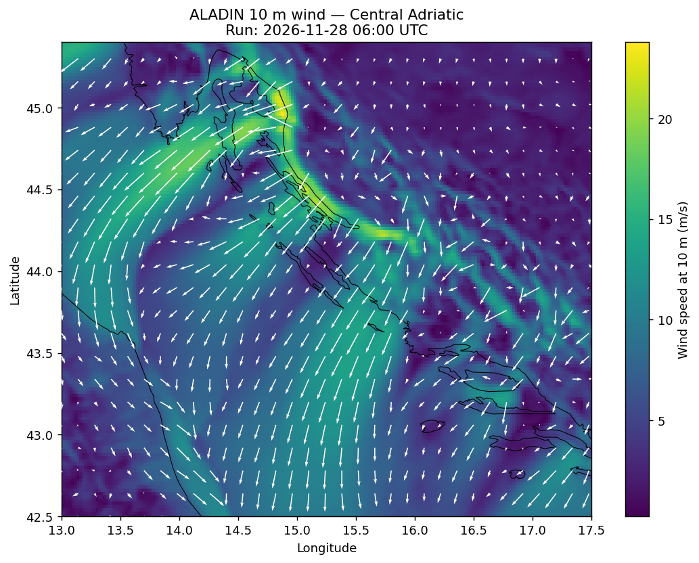

# ALADIN Adria GRIB Files

This branch (`gh-pages`) is automatically generated and contains processed GRIB files from the ALADIN weather model (wind, pressure, temperature) and from Copernicus Marine (surface currents, waves).

## Data status

- Wind (ALADIN): run 2026-11-28 06 UTC, OK, published 2026-11-28 14:20 UTC
- Water (Copernicus): reference time 2026-11-28 00 UTC, OK, published 2026-11-28 05:05 UTC, Copernicus data updated 2026-11-28 02:24 UTC, model MedFS EAS11 (currents) / MEDWAM4 (waves)



## About This Data

- **Wind source**: Czech Hydrometeorological Institute (CHMI) - ALADIN model, Lambert 2.3km grid
- **Water source**: Copernicus Marine, Mediterranean Sea Physics and Waves Analysis and Forecast, 1/24° grid
- **Region**: Adriatic Sea (13.0-17.5°E, 42.5-45.4°N)
- **Time frame**: wind: one ALADIN run, hourly steps 0-72; water: from 00 UTC of the day of the latest Copernicus update, hourly steps 0-108, so it always extends past the wind forecast
- **Wind resolution**: 0.02° (~2.2 km) regular lat-lon grid
- **Water resolution**: native 1/24° (~4 km) points, not regridded
- **Update frequency**: wind every 6 hours (CHMI), water up to three times a day (Copernicus); each file is rebuilt when its data is new
- **Wind file variables**:
  - Mean Sea Level Pressure (MSLP)
  - Wind Speed and Direction at 10m
  - Wind Gusts (u/v components)
  - Temperature at 2m
- **Water file variables**:
  - Surface current (ocean and tide), u/v components
  - Wave height, direction and period
  - Wind-sea and primary swell height, direction and period

## Usage

Download files here or get the latest run directly:
```bash
wget https://k-schreiber.github.io/aladin-grib-adria/aladin_adriacenter_latest.grb
wget https://k-schreiber.github.io/aladin-grib-adria/copernicus_adriacenter_latest.grb
```

Generated using E.U. Copernicus Marine Service Information; https://doi.org/10.48670/mds-00359 (currents), https://doi.org/10.48670/mds-00373 (waves).
